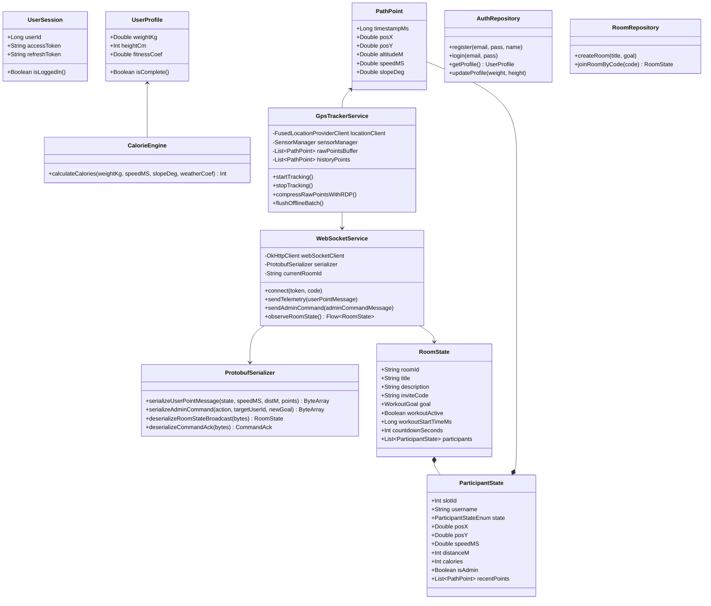
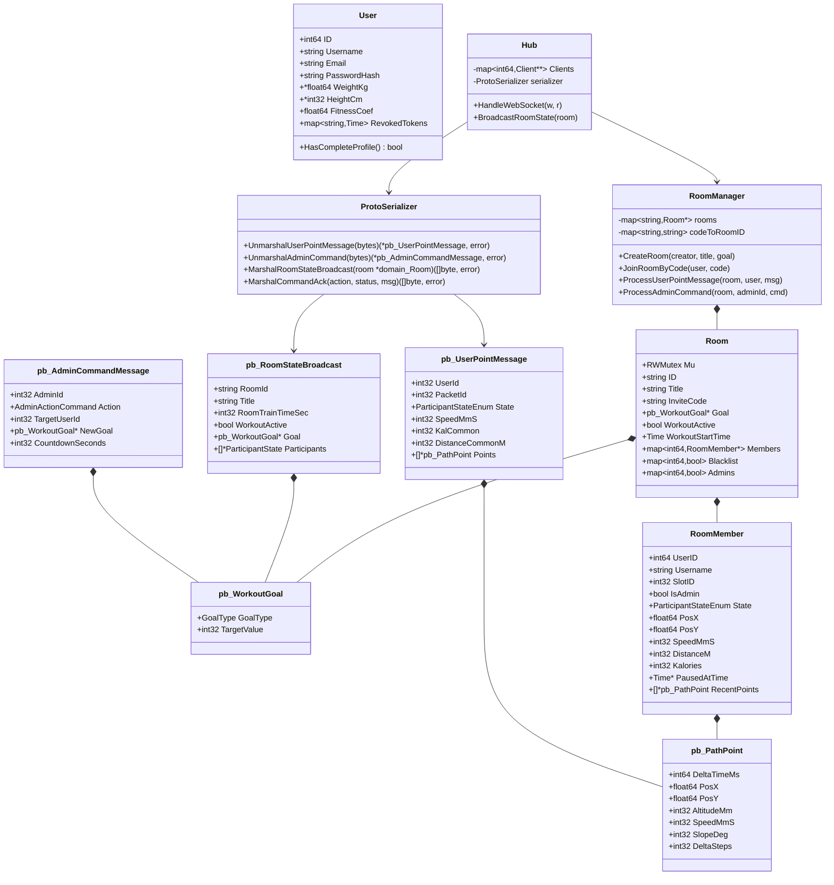

# Схема классов и структуры хранения данных SyncMate (Client & Server)

Документ описывает архитектуру классов, моделей данных, локальных хранилищ и **классов Сериализаторов/Десериализаторов Protobuf** для **Android-приложения (Kotlin + XML)** и **Go Бэкенда**.

---

## ❓ Что такое `SlotID` (Слот-Айди)?
> **`SlotID`** — это компактный 1-байтовый порядковый номер бегуна (1, 2, 3...), который сервер присваивает участнику в момент входа в конкретную комнату. 
> Вместо того чтобы каждую секунду передавать по радиоканалу 64-битные `user_id` или длинные UUID-строки, в бинарных Protobuf-сообщениях используется короткий 1-байтовый `SlotID`. Это экономит до 80% сокетного трафика в условиях слабого леса/EDGE.

---

## ⛰️ Что такое Высота (`Altitude`)?
> **Альтитуда (`altitude`)** — это абсолютная высота над уровнем моря (в метрах на клиенте или миллиметрах `altitude_mm` в Protobuf).
> Используется для вычисления уклонов дороги (`slopeDeg`), от которых напрямую зависит расчёт нагрузки и калорий движком `CalorieEngine`.

---

## 1. Схема классов Android-приложения (Client Side)

### 📋 Подробная выжимка по классам Android-клиента:

- **`UserSession`**: Хранит активный сессионный контекст авторизации на смартфоне (токены `accessToken`, `refreshToken` и `userId`). Отвечает за проверку статуса входа в приложение.
- **`UserProfile`**: Модель личных физических параметров бегуна (`weightKg`, `heightCm`, `fitnessCoef`). Служит первоисточником данных для расчёта сжигаемых калорий.
- **`PathPoint`**: Структура отдельной точки гео-маршрута на клиенте (`timestampMs` — точная метка времени Unix, координаты `posX`/`posY`, `altitudeM`, скорость в м/с `speedMS` и уклон `slopeDeg`).
- **`ParticipantState`**: Модель текущего состояния напарника по пробежке на карте (`slotId`, имя, статус `state`, текущая позиция, скорость, набранные километры, калории и массив точек `recentPoints`).
- **`RoomState`**: Главный экранный снимок комнаты. Хранит инвайт-код `inviteCode`, цель `goal`, статус активности `workoutActive`, таймер обратного отсчёта и список всех участников `participants`.
- **`ProtobufSerializer` (Сериализатор/Десериализатор Android)**: Модуль преобразования данных между удобными Kotlin-объектами (`RoomState`, `PathPoint`, `speedMS: Double`) и компактными сетевыми байтами Protobuf (`UserPointMessage`, `RoomStateBroadcast`). Конвертирует м/с в миллиметры в секунду (`speed_mm_s`), абсолютные миллисекунды в `delta_time_ms` и назад.
- **`GpsTrackerService`**: Android `ForegroundService` непрерывного сбора географических координат от датчиков. Разделяет свежий поток в `rawPointsBuffer` и сжатый RDP-алгоритмом итоговый трек в `historyPoints`.
- **`CalorieEngine`**: Модуль автономного расчёта калорий. Вычисляет энергозатраты на основе массы тела, текущей скорости `speedMS`, угла наклона поверхности `slopeDeg` и погодного коэффициента.
- **`WebSocketService`**: Транспортный агент бинарной сокет-связи. Управляет авто-переподключениями, использует `ProtobufSerializer` для кодирования и декодирования Protobuf-сообщений (`UserPointMessage`, `AdminCommandMessage`, `RoomStateBroadcast`).
- **`AuthRepository`**: HTTP REST клиент для авторизации, регистрации и обновления профиля (`/auth/register`, `/auth/login`, `/profile`).
- **`RoomRepository`**: HTTP REST клиент для создания комнат и первичной загрузки тяжелых данных по инвайт-ссылке (`/rooms`, `/rooms/join/:code`).

---

## 2. Схема структур и классов Go Сервера (Server Side)

### 📋 Подробная выжимка по структурам Go-сервера:

- **`pb_PathPoint`**: Бинарная Protobuf-структура точки маршрута при передаче по сети (`DeltaTimeMs`, `PosX`, `PosY`, `AltitudeMm`, `SpeedMmS`, `SlopeDeg`, `DeltaSteps`).
- **`pb_WorkoutGoal`**: Бинарная Protobuf-структура цели тренировки (`GoalType` — дистанция/время/калории, `TargetValue` — целевое значение).
- **`pb_UserPointMessage`**: Пакет телеметрии от бегуна к серверу. Несет текущий `State`, набранные километры, калории и оффлайн-батч точек `Points`.
- **`pb_AdminCommandMessage`**: Пакет управляющей команды от администратора (`BEGIN`, `TERMINATE`, `BAN`, `UNBAN`, `SET_GOAL`, `SET_START_COUNTDOWN`).
- **`pb_RoomStateBroadcast`**: Скомпрессованный кадр состояния комнаты, который сервер рассылает всем подключенным сокетам.
- **`ProtoSerializer` (Сериализатор/Десериализатор Go)**: Серверный шлюз распаковки и упаковки бинарного Protobuf-трафика. Переводит входящие байты сокета `[]byte` в структуры `pb.UserPointMessage` / `pb.AdminCommandMessage`, а также собирает доменные структуры `domain.Room` и `domain.RoomMember` в финальный бинарный пакет `pb.RoomStateBroadcast` для рассылки всем клиентам.
- **`User`**: Запись учетной записи в памяти бэкенда (`ID`, `Email`, хэш пароля bcrypt, рост, вес, `RevokedTokens` для инвалидации сессий).
- **`RoomMember`**: Внутреннее состояние участника в оперативной памяти сервера (`UserID`, выданный `SlotID`, статус `State`, `PausedAtTime` для точной фиксации времени паузы и накопленные точки `RecentPoints`).
- **`Room`**: Модель тренировочной комнаты с потокобезопасным мьютексом `sync.RWMutex`, маппингом участников `Members`, изолированным Черным списком `Blacklist` и пулом админов `Admins`.
- **`RoomManager`**: Сердце бизнес-логики сервера. Создает комнаты, генерирует уникальные инвайт-коды `RUN-XXXXXX`, обрабатывает батчи и команды, следит за разбаном с 0 и удаляет неактивные комнаты раз в 15 минут.
- **`Hub`**: Высоконагруженный сокетный хаб. Управляет сокет-соединениями `Client`, использует `ProtoSerializer` для безопасного анмаршалинга, проверяет подлинность `SlotID` (защита от спуфинга), ограничивает размер кадра (защита от OOM до 1 МБ) и рассылает кадры комнат.
